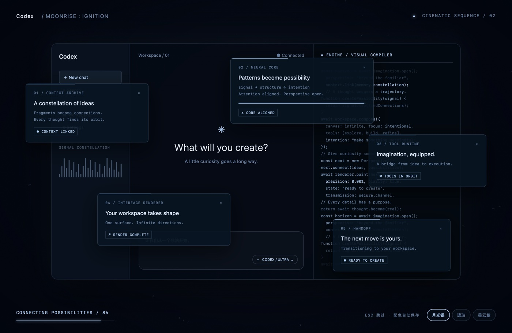
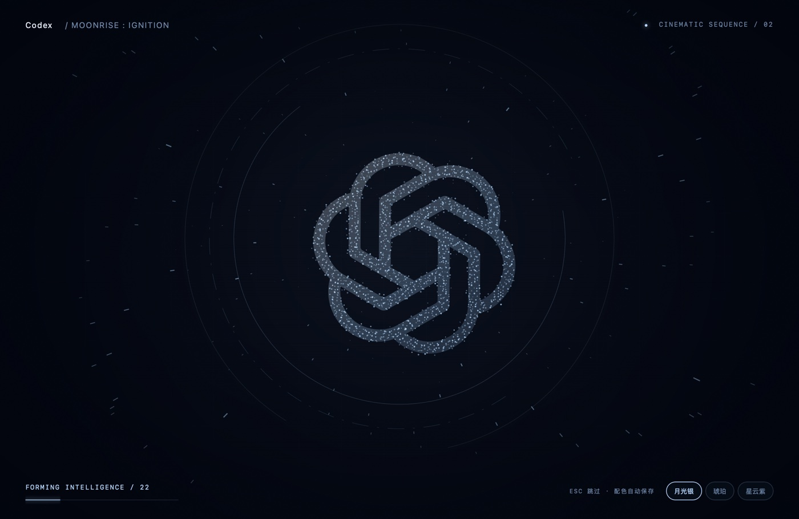

# Codex Moonrise · Ignition

**给 macOS 上的 Codex 一个 14 秒的电影感开场。**

星际穿梭 → 粒子标志重组 → 字标显现 → 立体工作台 → 代码流与悬浮面板 → CRT 收束 → 真实 Codex。

[下载 macOS 版本](https://github.com/swording-k/codex-moonrise/releases/latest) · [在线体验](https://swording-k.github.io/codex-moonrise/) · [重启快捷指令配置](Shortcuts/README.md) · [English](#english) · [MIT License](LICENSE)



## 怎么用

1. 从 **Releases** 下载 `Codex-Moonrise-macOS-universal.zip`，解压。
2. 把 **Codex Moonrise.app** 拖进“应用程序”。
3. 双击启动，或把它拖进 Dock，以后点击这个图标。

**不需要先打开 Codex，也不需要为了播放动画退出它。**

| Codex 状态 | 启动器的行为 |
| --- | --- |
| 尚未运行 | 启动已安装的 Codex，播放动画后切换过去 |
| 已经运行 | 复用现有客户端，动画结束后回到当前工作区 |
| 未安装 | 明确提示找不到客户端 |

这是独立启动器。**点击原来的 Codex / ChatGPT 图标不会触发动画**；从 Moonrise 图标打开才会播放。应用通过 bundle ID `com.openai.codex` 发现客户端，因此即使本机应用名字显示为 ChatGPT，也能识别这个 Codex 发行版；不兼容其他 bundle ID 的独立 ChatGPT 客户端。

不会改写官方应用、替换签名、注入代码，也不会修改你的 Dock 或聊天记录。

> 下载包使用本地 ad-hoc 签名，尚未做 Apple Developer ID 签名与公证；其他 Mac 首次打开时可能被 Gatekeeper 拦截。也提供完整源码，可自行构建。

## 想像视频里一样：点击一个图标，重启并播放动画

可用 macOS 自带的「快捷指令」把原来的启动入口接到 Moonrise：

```text
退出真正的 Codex / ChatGPT → 等待 3 秒 → 打开 Codex Moonrise
```

**没运行时启动，已运行时退出重开**。配置完成后可添加到 Dock，或继续使用原来指向该快捷指令的桌面组件。已有重启快捷指令只需把最后的「打开 ChatGPT」改成「打开 Codex Moonrise」。

[查看三步配置教程、常见问题与核对方法 →](Shortcuts/README.md)

[拍视频用的镜头顺序与口播文案 →](docs/video-guide.md)

直接点击 Moonrise 本身仍会复用现有客户端。只有这套快捷指令入口负责真正的重启；官方客户端原图标保持不变。

## 不只有一种颜色

- **月光银**：冰蓝星空与银白标志。
- **琥珀**：暖金粒子与暮色面板。
- **星云紫**：紫色轨道与冷光界面。

动画右下角可切换，或按 **1 / 2 / 3**；启动器会记住选择。**Esc** 随时跳过。



## 在线预览

[打开浏览器演示](https://swording-k.github.io/codex-moonrise/)。演示只播放动画，不会启动你的本机应用。结束后停留在字标，可重播、切换配色。

浏览器和原生启动器分别保存配色。所有画面由本地 Canvas / CSS 绘制，无 CDN、无模型 API、无音频或遥测。

代码、面板和进度都是艺术化场景，**不代表真实模型、工具或聊天上下文的加载状态**。

## 从源码构建

需要 macOS、Xcode Command Line Tools；无需 npm、Electron 或第三方依赖。

```sh
git clone https://github.com/swording-k/codex-moonrise.git
cd codex-moonrise
./Source/build.sh
open "Codex Moonrise.app"
```

脚本构建 arm64 + x86_64 的 Universal 应用，并在本地签名。最低部署目标 macOS 13；实际测试环境为 Apple Silicon / macOS 27。Intel 版本已编译并检查架构，尚未在 Intel 硬件上测试。

```sh
# 完整时序与 bridge（14 秒）
"./Codex Moonrise.app/Contents/MacOS/Moonrise" --verify
# 原生 Esc 键事件
"./Codex Moonrise.app/Contents/MacOS/Moonrise" --verify-native-skip
# 配色 bridge 与持久化（验证后恢复原偏好）
"./Codex Moonrise.app/Contents/MacOS/Moonrise" --verify-palette
# 仅播放，不启动 Codex
"./Codex Moonrise.app/Contents/MacOS/Moonrise" --preview
```

系统启用“减少动态效果”时，会移除穿梭、聚合、旋转和 CRT 缩放。22 秒超时兜底撤下覆盖层。

## 项目结构

| 文件 | 内容 |
| --- | --- |
| `Source/main.swift` | AppKit 窗口、WKWebView、客户端发现、交接、配色与验证 |
| `Preview/index.html` | 独立动画源码与浏览器演示 |
| `Source/build.sh` | Universal 构建和本地签名 |
| `Shortcuts/README.md` | 三步配置启动／重启快捷指令 |
| `docs/video-guide.md` | 拍视频的演示顺序与口播文案 |
| `docs/index.html` | GitHub Pages 演示，与 Preview 保持一致 |
| `.github/workflows/build.yml` | macOS 构建、架构和签名检查 |

冷启动通过 `NSWorkspace.openApplication` 实现；完成动画后激活客户端。已实测正在运行的 Codex 的复用与交接，尚未通过关闭活跃聊天来验证冷启动。没有检测客户端内部页面就绪，动画不会等待实际任务加载完成。

## 致谢

参考 [Artemis / Tom 的 codex-startup-animation](https://github.com/yshuang722-spec/codex-startup-animation)，延续“独立启动器 + 动画覆盖 + 真实客户端交接”的思路，复用其标志矢量几何。本项目重新实现了 macOS 外壳、时间线与视觉场景。原项目 Windows 版本同样通过专用启动器/快捷方式打开，不会修改原客户端。

代码以 MIT 协议发布，保留 [原项目许可](REFERENCE-LICENSE.txt) 与 [第三方声明](THIRD_PARTY_NOTICES.md)。这是非官方社区作品，与 OpenAI 无隶属或官方认可关系；品牌与标志归各自权利人所有。

## English

A 14-second cinematic macOS launcher for Codex: a starfield warp, particle logo assembly, a dimensional workspace, streaming code, floating panels, and a CRT handoff to the real application.

Download the Universal app from **Releases**, move it to **Applications**, and launch it from Finder or the Dock. It starts Codex if needed and reuses an existing instance otherwise. **The original Codex icon is unchanged**. Press **Esc** to skip; **1 / 2 / 3** switch persistent Silver, Amber, and Violet palettes.

Requires an installed client with bundle ID `com.openai.codex`. Builds target macOS 13+ and contain Apple Silicon and Intel code; tested on Apple Silicon/macOS 27 only. Downloads are ad-hoc signed and not Apple-notarized. No Electron, external runtime, network requests, API key, or modification of the official client is required.

For restart-on-click behavior, see the [Shortcuts setup guide](Shortcuts/README.md#english-quick-setup): Quit the real client → Wait 3 seconds → Open Codex Moonrise. The normal launcher continues to reuse an existing client.

Build with `./Source/build.sh`. See [Third-party notices](THIRD_PARTY_NOTICES.md) for upstream attribution. This is an unofficial community project, not affiliated with or endorsed by OpenAI.
